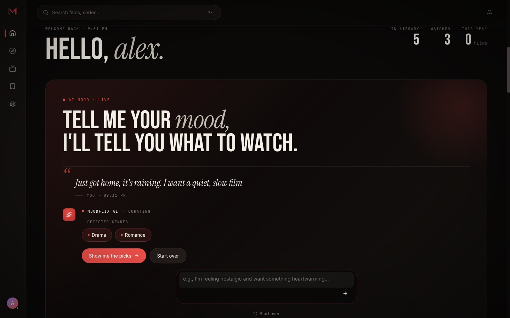
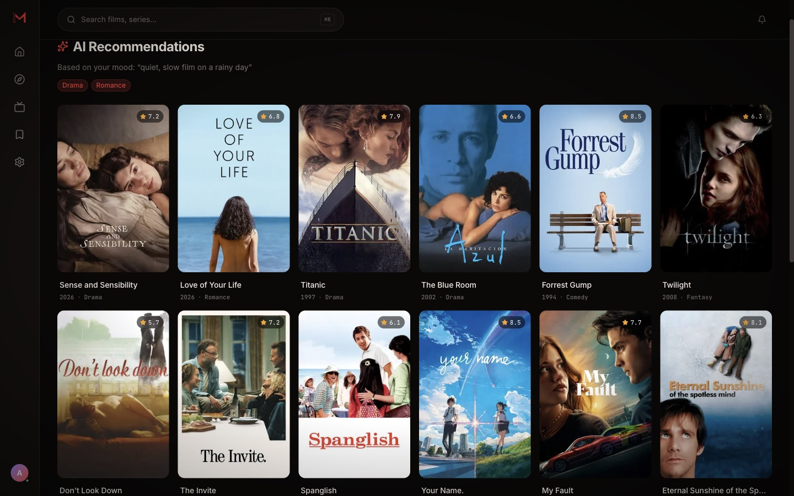
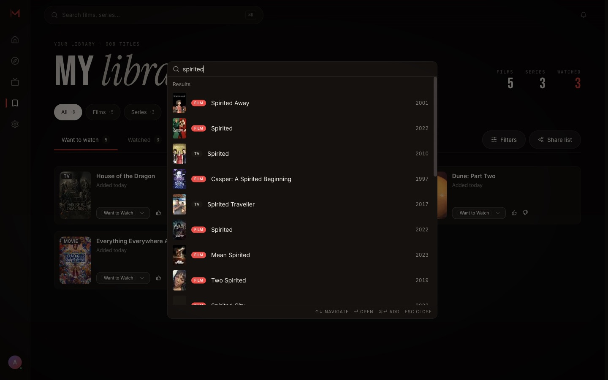
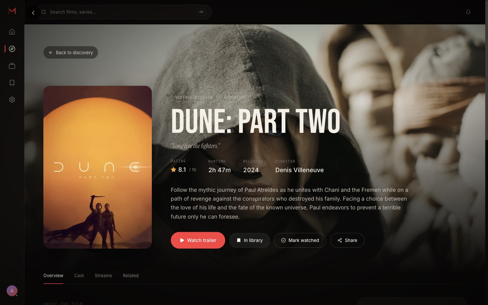
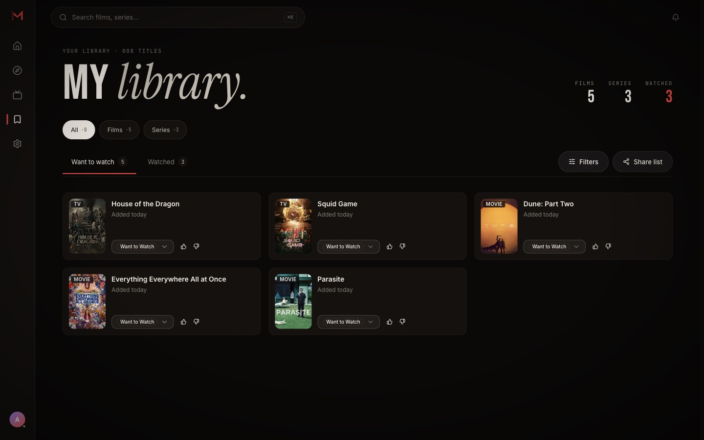

# Moodflix

Moodflix helps you decide what to watch. Describe how you feel in a sentence, get films and series that fit, keep a library of what you want to watch and what you've seen, and see where each title is streaming in your country.

**Try it:** [moodflix.yuliuskevin.com](https://moodflix.yuliuskevin.com). It's free and needs only an email address or a Google account.



Moodflix is an early-stage project built and run by one person. Expect rough edges, and expect features to change.

## What you can do

| | |
| --- | --- |
| **Ask by mood.** Type a feeling ("something cozy for a rainy evening") or tap a suggestion. The AI picks matching genres and opens a page of titles. Follow-up messages refine the picks. | **Search everything.** Press <kbd>⌘</kbd> <kbd>K</kbd> (<kbd>Ctrl</kbd> <kbd>K</kbd> on Windows and Linux) to search films and series from any page. |
|  |  |
| **Open any title.** See the synopsis, cast, trailer, rating, runtime, and the services streaming it in your region. | **Keep a library.** Save films and series as *Want to watch* or *Watched*, give them a thumbs up or down, and filter by type. |
|  |  |

You can also:

- **Browse** trending, popular and top-rated rows, or filter films and series by genre, on the *Movies* and *Series* tabs.
- **Get a release alert** for an upcoming film. Tap the bell on its page and Moodflix sends one push notification when it's released.
- **Install it as an app** on your phone or desktop. It works like a native app and shows an offline page when you lose your connection.

## Getting started

1. Open [moodflix.yuliuskevin.com](https://moodflix.yuliuskevin.com) and choose **Start free**.
2. Sign up with an email and password, or continue with Google. There's no confirmation email; you go straight to your home screen.
3. Under **Tell me your mood**, describe what you're in the mood for and press <kbd>Enter</kbd>. When genres appear, choose **Show me the picks**.
4. Open a title you like and choose **Add to library**. Change its status to *Watched* later from the title page or from **Library**.

### Keyboard shortcuts

| Keys | What it does |
| --- | --- |
| <kbd>⌘</kbd> <kbd>K</kbd> / <kbd>Ctrl</kbd> <kbd>K</kbd> | Open search |
| <kbd>↑</kbd> <kbd>↓</kbd> | Move through search results |
| <kbd>Enter</kbd> | Open the selected result |
| <kbd>⌘</kbd> <kbd>Enter</kbd> / <kbd>Ctrl</kbd> <kbd>Enter</kbd> | Add the selected result to your library without leaving search |
| <kbd>Esc</kbd> | Close search |

Search remembers your recent queries on that device. Use **Clear** in the search palette to forget them. Signing out clears them too.

### Install the app

- **Chrome, Edge (desktop or Android):** open the site and choose the install icon in the address bar, or *Install app* from the browser menu.
- **Safari on iPhone or iPad:** tap **Share**, then **Add to Home Screen**.

## How the mood search works

When you send a mood, Moodflix passes your message and recent conversation to Google Gemini. The model answers with a set of [TMDB](https://www.themoviedb.org/) genres, and for some requests a country of origin (for example, "K-drama" means Korean series). Moodflix then asks TMDB for titles in those genres. Titles already in your library tell the model what you liked, so it can personalize its answer.

- Each account can send **10 mood requests per day**. Search, browsing and your library have no daily limit.
- Messages are text only, up to 500 characters each.
- The assistant only talks about films and series. Off-topic questions get a short redirect.

## Release alerts

Release alerts use your browser's push notifications.

1. On the page of a film that hasn't been released yet, tap the bell.
2. Allow notifications when your browser asks.
3. Moodflix checks for releases once a day. When the film is out, you get one notification and an entry in the bell menu at the top of the app.

Tap the bell again to cancel. Each account can follow up to 100 upcoming films and register up to 5 devices.

Supported: Chrome, Edge, Firefox, and Safari 16.4 or later (on iPhone and iPad, install the app to the Home Screen first). Browsers that use a different push service, such as some Chromium-based browsers, show *Notifications aren't supported on this browser*.

## Your data

| What | Where it goes |
| --- | --- |
| Account (email, sign-in method) | Supabase Auth |
| Library, ratings, release alerts, notification inbox | Moodflix database (Supabase Postgres) |
| Mood messages and the genres returned | Sent to Google Gemini to produce an answer, and stored with your account |
| Recent searches | Only in your browser, separated per account |
| Error reports | Sentry, with request bodies, headers, cookies, IP addresses and text in session replays removed |

Moodflix doesn't sell data or show ads. Where-to-watch results use your approximate country from your connection and default to the United States. See the [privacy policy](https://moodflix.yuliuskevin.com/privacy) for details. To delete your account and its data, email [hello@yuliuskevin.com](mailto:hello@yuliuskevin.com).

## Troubleshooting

**The mood search says I've hit the limit.**
The allowance of 10 requests resets within 24 hours. Search, browsing and your library keep working in the meantime.

**The bell does nothing, or says notifications are blocked.**
Notifications were denied for this site. Allow them in your browser's site settings, then tap the bell again.

**A streaming service is missing from a title.**
Availability comes from JustWatch through TMDB and varies by country. Some titles have no data for your region yet.

**I see "Updating session…".**
You signed in or out in another tab. The page reloads with the current account.

## Run it yourself

Moodflix is a [Next.js](https://nextjs.org/) 16 app. To run your own copy, you need Node.js 22 or newer and accounts for [Supabase](https://supabase.com/), [TMDB](https://www.themoviedb.org/settings/api), and [Google AI Studio](https://aistudio.google.com/) (for Gemini).

```bash
git clone https://github.com/yeka157/moodflix.git
cd moodflix
npm install
cp .env.example .env.local   # then fill in the values below
npm run db:migrate
npm run dev                  # http://localhost:3000
```

| Variable | What it's for |
| --- | --- |
| `NEXT_PUBLIC_SUPABASE_URL`, `NEXT_PUBLIC_SUPABASE_PUBLISHABLE_DEFAULT_KEY` | Supabase project URL and publishable key |
| `SUPABASE_SECRET_KEY` | Server-side Supabase admin access |
| `DATABASE_URL` | Supabase transaction pooler (port 6543), used at runtime |
| `DATABASE_URL_DIRECT` | Supabase session pooler (port 5432), used for migrations |
| `TMDB_API_READ_KEY` | TMDB **API Read Access Token** (not the v3 API key) |
| `GOOGLE_GENERATIVE_AI_API_KEY` | Gemini API key |
| `NEXT_PUBLIC_VAPID_PUBLIC_KEY`, `VAPID_PRIVATE_KEY`, `VAPID_SUBJECT` | Web push keys (`npx web-push generate-vapid-keys`) and a `mailto:` contact |
| `CRON_SECRET` | Protects the daily release-alert job |

On a new database, run `drizzle/seed.sql` and `drizzle/rls-policies.sql` in the Supabase SQL Editor after migrating. [DRIZZLE_GUIDE.md](DRIZZLE_GUIDE.md) covers schema changes.

| Command | What it does |
| --- | --- |
| `npm run dev` | Start the development server |
| `npm run build` | Production build, including type checks |
| `npm run quality` | Biome (Ultracite) and Next.js ESLint checks |
| `npm run test:security` | Offline regression tests for API validation and limits |
| `npm run db:generate` / `db:migrate` / `db:studio` | Create migrations, apply them, browse data |

Built with Next.js, React 19, Tailwind CSS v4, shadcn/ui, Supabase, Drizzle ORM, the Vercel AI SDK with Gemini, TanStack Query and Serwist. It's deployed on Vercel, which also runs the daily release check.

## Credits

Film and series data, images and streaming availability come from [TMDB](https://www.themoviedb.org/), with streaming data from [JustWatch](https://www.justwatch.com/). This product uses the TMDB API but is not endorsed or certified by TMDB.
